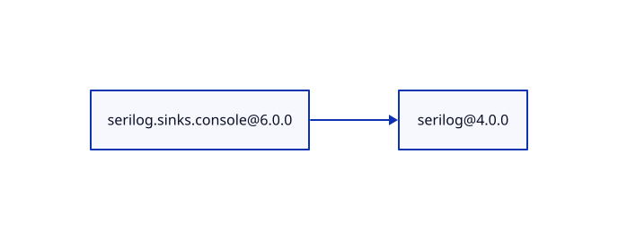
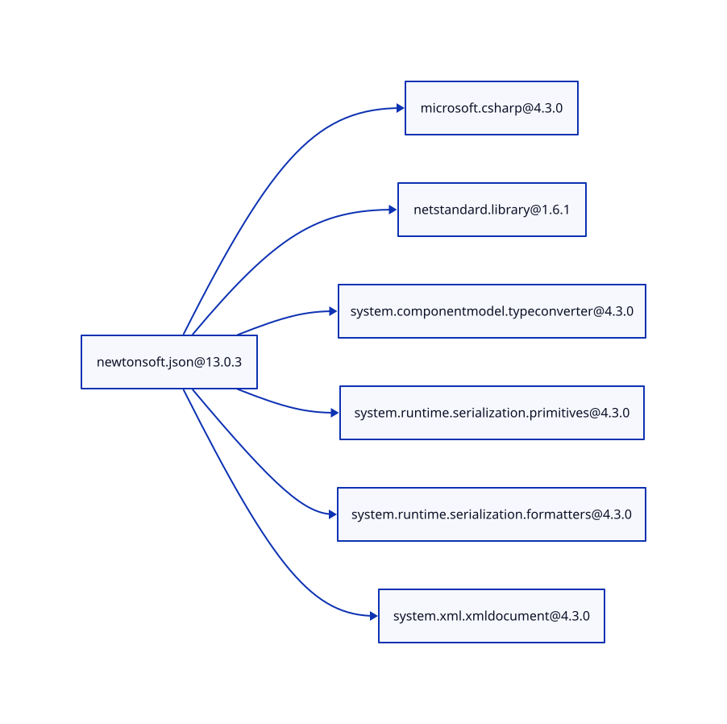
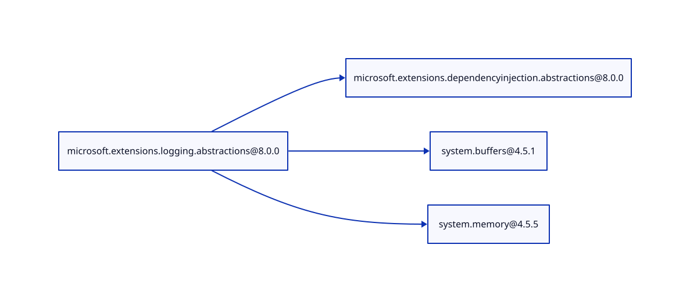

# depgraph — визуализация зависимостей NuGet

Практическая работа № 2 по дисциплине «Конфигурационное управление», вариант 26.

## 1. Общее описание

`depgraph` — консольное Java-приложение для анализа зависимостей пакетов NuGet.
На пятом этапе оно выводит граф на языке диаграмм **D2** и по запросу показывает
дополнительное **ASCII-дерево**. Стрелка графа направлена от пакета к его
зависимости. Предыдущие этапы сохранены в отдельных ветках репозитория.

Граф строится рекурсивным обходом в глубину (DFS). При построении учитываются
максимальная глубина и фильтр имён. Циклы сохраняются как рёбра графа, а в
ASCII-дереве помечаются и не вызывают бесконечного обхода.

Для работы нужна Java 17 или новее. Приложение самостоятельно получает метаданные
по HTTP и разбирает XML стандартными средствами Java. Менеджеры пакетов и сторонние
библиотеки для получения зависимостей в приложении не используются.

## 2. Функции и настройки

| Опция | Обязательна | По умолчанию | Описание |
|---|---|---|---|
| `--package <имя>` | да | — | Исходный пакет; для тестового файла — заглавные латинские буквы |
| `--repo <url\|путь>` | да | — | URL индекса NuGet v3, адрес хранилища или путь к тестовому файлу |
| `--repo-mode <режим>` | нет | `remote` | `remote` — NuGet, `test` — файл с описанием графа |
| `--version <версия>` | нет | `latest` | Версия исходного пакета, например `6.0.0` |
| `--max-depth <число>` | нет | `5` | Максимальная глубина от 1 до 1000 |
| `--filter <подстрока>` | нет | пусто | Исключить пакеты, содержащие подстроку в имени |
| `--ascii-tree` | нет | `false` | После D2 дополнительно вывести дерево |
| `--help` | нет | — | Вывести справку |

### Построение графа

- Исходный пакет находится на глубине 0, а его прямые зависимости — на глубине 1.
  Зависимости вершин, достигнутых на предельной глубине, не загружаются. В D2
  выводится предупреждение-комментарий; в дереве вершина помечается
  `(предел глубины)`. Отсутствие её дочерних узлов не означает, что у пакета
  нет собственных зависимостей.
- Фильтр сравнивается с именем пакета без учёта регистра. Пакет, совпавший с
  фильтром, и переход к нему исключаются. Если исключён исходный пакет, граф пуст.
- Если у разных пакетов есть общая зависимость, в D2 это одна вершина с несколькими
  входящими рёбрами. В дереве её повторное появление отмечается `(уже показан)`;
  дочерняя ветвь повторно не раскрывается.
- В D2 циклические рёбра сохраняются. В ASCII-дереве повторение вершины на текущем
  пути помечается `(цикл)`, после чего эта ветвь заканчивается.
- В графе могут одновременно присутствовать разные версии одного пакета. Версия
  отображается после `@`, например `serilog@4.0.0`.

### Как формируется D2

Программа назначает каждой вершине технический идентификатор `n1`, `n2` и так
далее. Рядом с идентификатором записывается настоящее имя пакета, а ниже — стрелки:

```d2
direction: right
n1: "A"
n2: "B"
n1 -> n2
```

Это описание означает: пакет `A` зависит от `B`; направление задано слева направо.
Идентификаторы позволяют корректно
выводить имена NuGet с точками и версиями. Вершины без рёбер тоже объявляются,
поэтому пакет без зависимостей будет виден на диаграмме.

По умолчанию программа выводит **только D2**, пригодный для сохранения в `.d2`.
Если передать `--ascii-tree`, после D2 дополнительно выводится дерево; для создания
D2-файла запускайте команду без этой опции.

### Тестовый репозиторий

Тестовый файл содержит по одному пакету на строку:

```text
A: B C
B: D
C: D E
D:
E: A
```

Имена состоят из заглавных латинских букв. Зависимость без собственной строки
считается вершиной без зависимостей. Исходный пакет должен присутствовать в файле;
повторяющиеся строки одного пакета недопустимы. В `tests/data/test_repo.txt` есть
общая зависимость `D` и цикл `A -> C -> E -> A`; файл
`tests/data/acyclic_repo.txt` содержит похожий граф без цикла.

### Работа с реальным NuGet

Программа читает ресурс `PackageBaseAddress` из индекса NuGet v3 и получает файлы
`.nuspec` нужных версий. Поддерживаются диапазоны вроде `[1.0, 2.0)`, точные
версии `[1.0]`, нижние границы `1.0` и числовые шаблоны `1.*`. Для обычного
диапазона выбирается наименьшая подходящая версия; для `latest` и шаблона с `*` —
наибольшая подходящая версия.

Для исходного пакета `latest` выбирается последняя стабильная версия, а если их
нет — последняя предварительная. Для диапазонов предварительные версии учитываются,
когда они указаны в ограничении. Неподдерживаемое ограничение вызывает ошибку.

`.nuspec` может содержать группы зависимостей для разных платформ .NET. Платформа
в программе не задаётся: в граф включается объединение групп, а одинаковые рёбра
удаляются. Версии подбираются отдельно для каждого ребра; полный выбор платформы
и разрешение конфликтов NuGet здесь не реализованы. Поэтому результат может
отличаться от графа конкретного проекта в NuGet.

### Структура проекта

- `src/depgraph/Main.java` — запуск, параметры и вывод;
- `src/depgraph/GraphVisualizer.java` — формирование D2 и ASCII-дерева;
- `src/depgraph/DependencyGraph.java` — построение графа, фильтр, глубина и циклы;
- `src/depgraph/Config.java` — разбор и проверка параметров;
- `src/depgraph/NugetRepository.java` — получение метаданных NuGet;
- `src/depgraph/NugetVersion.java`, `VersionRange.java` — работа с версиями;
- `src/depgraph/TestRepository.java` — чтение тестового репозитория;
- `src/depgraph/DependencyOrder.java` — сохранённая логика порядка этапа 4;
- `tests/depgraph/` и `tests/data/` — тесты и тестовые репозитории;
- `examples/` — D2-файлы и SVG-диаграммы трёх реальных пакетов;
- `comparison/` — проекты для сравнения с NuGet.

## 3. Сборка и проверка

Требуется JDK 17 или новее; `java` и `javac` должны быть доступны в `PATH`.
Если задана переменная `JAVA_HOME`, Windows-скрипты используют оба инструмента
из указанного JDK. Файлы сборки помещаются в игнорируемую папку `build/`.

Windows, PowerShell:

```powershell
.\test.bat
.\demo.bat
```

Linux / macOS:

```sh
./test.sh
./demo.sh
```

`test` проверяет параметры, репозиторий, версии, граф, порядок этапа 4 и
визуализацию. `demo` показывает графы для трёх тестовых пакетов: `A` с циклом и
общей зависимостью, `B` с одной зависимостью и `D` без зависимостей. Также
показываются ограничение глубины и фильтр. Для этих команд интернет не нужен.

## 4. Примеры использования

### Тестовый граф

```powershell
.\run.bat --package A --repo tests\data\test_repo.txt --repo-mode test --max-depth 5 --ascii-tree
```

Программа выведет D2 и следующее дерево:

```text
A
|-- B
|   `-- D
`-- C
    |-- D (уже показан)
    `-- E
        `-- A (цикл)
```

Пакет `D` без зависимостей:

```powershell
.\run.bat --package D --repo tests\data\test_repo.txt --repo-mode test --ascii-tree
```

### Три реальных пакета

Для запросов к NuGet нужен интернет. В примерах задана глубина 1, поэтому показаны
исходный пакет и его прямые зависимости; транзитивные зависимости не раскрываются.
Текст D2 и изображение получены из вывода этой программы; SVG создан внешней
утилитой D2. Снимки приведены для указанных версий пакетов.

**1. Serilog.Sinks.Console 6.0.0**

```powershell
.\run.bat --package Serilog.Sinks.Console --repo https://api.nuget.org/v3/index.json --version 6.0.0 --max-depth 1 --ascii-tree
```

В графе: `Serilog.Sinks.Console 6.0.0 -> Serilog 4.0.0`.
[Описание D2](examples/serilog.d2) · [Диаграмма SVG](examples/serilog.svg)



**2. Newtonsoft.Json 13.0.3**

```powershell
.\run.bat --package Newtonsoft.Json --repo https://api.nuget.org/v3/index.json --version 13.0.3 --max-depth 1 --ascii-tree
```

Граф содержит зависимости из нескольких групп платформ .NET, в том числе
`Microsoft.CSharp 4.3.0` и `NETStandard.Library 1.6.1`.
[Описание D2](examples/newtonsoft.d2) · [Диаграмма SVG](examples/newtonsoft.svg)



**3. Microsoft.Extensions.Logging.Abstractions 8.0.0**

```powershell
.\run.bat --package Microsoft.Extensions.Logging.Abstractions --repo https://api.nuget.org/v3/index.json --version 8.0.0 --max-depth 1 --ascii-tree
```

Граф содержит `Microsoft.Extensions.DependencyInjection.Abstractions 8.0.0`,
`System.Buffers 4.5.1` и `System.Memory 4.5.5`.
[Описание D2](examples/logging.d2) · [Диаграмма SVG](examples/logging.svg)



### Как получить изображение из D2

Для генерации текста D2 программа не требует установки D2. Чтобы преобразовать его
в изображение, установите утилиту [D2](https://d2lang.com/tour/install/) и выполните
в PowerShell, например:

```powershell
.\run.bat --package A --repo tests\data\test_repo.txt --repo-mode test | Out-File -Encoding utf8 graph.d2
d2 graph.d2 graph.svg
```

Первую команду следует выполнять без `--ascii-tree`: тогда в файл попадёт только
текст D2. Вторая команда создаёт изображение `graph.svg`. Утилита D2 нужна только
для изображения и не участвует в получении зависимостей.

## 5. Сравнение со штатным инструментом NuGet

Проверка выполнена с .NET SDK `8.0.428` для проектов `net8.0`. Штатная команда
[`dotnet nuget why`](https://learn.microsoft.com/en-us/dotnet/core/tools/dotnet-nuget-why)
показывает дерево путей к выбранному пакету; `dotnet list package --include-transitive`
показывает состав пакетов проекта. Команды сравнения используются отдельно от
Java-программы и не участвуют в получении ею зависимостей.

| Исходный пакет | Что показал NuGet для `net8.0` | Что показал depgraph при глубине 1 |
|---|---|---|
| Serilog.Sinks.Console 6.0.0 | Путь к `Serilog 4.0.0` | Та же прямая связь |
| Newtonsoft.Json 13.0.3 | Пакет без дополнительных NuGet-зависимостей | Шесть зависимостей из объединения групп, включая `Microsoft.CSharp` и `NETStandard.Library` |
| Microsoft.Extensions.Logging.Abstractions 8.0.0 | Путь к `Microsoft.Extensions.DependencyInjection.Abstractions 8.0.0` | Та же связь, а также `System.Buffers 4.5.1` и `System.Memory 4.5.5` |

Расхождения объясняются тем, что NuGet выбирает зависимости для конкретной
платформы `net8.0`, а программа объединяет группы `.nuspec` для разных платформ.
Кроме того, NuGet разрешает конфликтующие версии в контексте всего проекта, а
программа подбирает версии отдельно для каждого ребра. Максимальная глубина 1
ограничивает сравнение прямыми зависимостями программы.

Для повторения сравнения нужны интернет и .NET SDK версии 8.0.4xx или новее:

```powershell
dotnet restore .\comparison\NugetComparison.csproj
dotnet nuget why .\comparison\NugetComparison.csproj Serilog --framework net8.0

dotnet restore .\comparison\json\JsonComparison.csproj
dotnet nuget why .\comparison\json\JsonComparison.csproj Newtonsoft.Json --framework net8.0
dotnet list .\comparison\json\JsonComparison.csproj package --include-transitive

dotnet restore .\comparison\logging\LoggingComparison.csproj
dotnet nuget why .\comparison\logging\LoggingComparison.csproj Microsoft.Extensions.DependencyInjection.Abstractions --framework net8.0
```

Граф, восстановленный NuGet, также записывается в файл `obj/project.assets.json`
рядом с соответствующим сравнительным проектом. Эти файлы являются результатами
сборки и не добавляются в Git. Для запуска `depgraph` .NET SDK не нужен.
